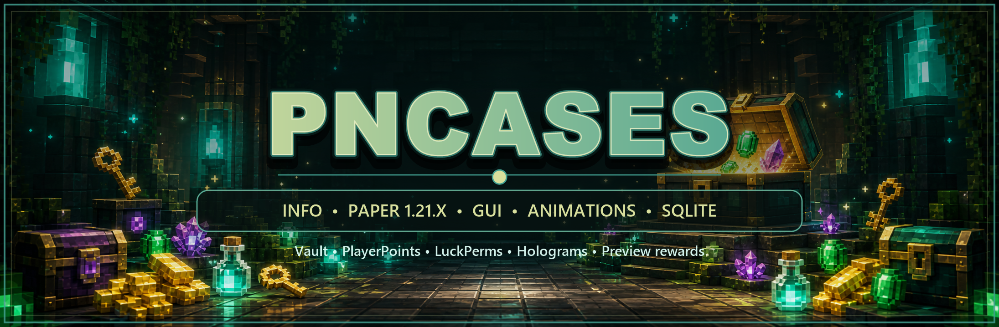

<p align="center">
  
</p>

<h1 align="center">pnCases</h1>

<p align="center">
  Настраиваемая система кейсов для Paper и Purpur с анимациями,
  виртуальными ключами, витринами, голограммами и Machine GUI.
</p>

<p align="center">
  <a href="https://github.com/Dy6HiLa/pnCases/releases/download/v1.5.2/pnCases-1.5.2.jar">
    
  </a>
  <a href="https://github.com/Dy6HiLa/pnCases/releases/tag/v1.5.2">
    
  </a>
  <a href="https://discord.gg/J2cTeTQsy8">
    
  </a>
</p>

<p align="center">
  
  
  
</p>

## Возможности

- Каждый кейс хранится отдельно в `plugins/pnCases/cases/<id>.yml`.
- Создание и полная настройка кейсов без заранее заданных типов.
- Один виртуальный ключ на кейс: ID ключа всегда совпадает с ID кейса.
- Типы наград: `ITEM`, `VAULT`, `PLAYERPOINTS`, `LUCKPERMS`, `PERSONAL`.
- Кастомные предметы и головы через Base64.
- Редкости `COMMON`, `UNCOMMON`, `RARE`, `EPIC`, `LEGENDARY`, `MYTHIC`.
- Настраиваемые шансы, сообщения наград и broadcast для каждого кейса.
- Предпросмотр содержимого, история открытий и выбор анимации игроком.
- Machine GUI для настройки меню, голограммы, витрины, анимации и покупки ключа за опыт.
- Точечное обновление слотов GUI через ProtocolLib без полного переоткрытия меню.
- Голограммы через FancyHolograms или DecentHolograms.
- Хранение ключей, истории, выбранных анимаций и pending-наград в SQLite, MySQL или MongoDB.

## Установка

1. Скачайте [pnCases-1.5.2.jar](https://github.com/Dy6HiLa/pnCases/releases/download/v1.5.2/pnCases-1.5.2.jar).
2. Поместите JAR в папку `plugins/`.
3. Полностью перезапустите сервер.
4. Создайте кейс командой `/pncases createcase <id>`.
5. Настройте `plugins/pnCases/cases/<id>.yml` или используйте `/pncases machine <id>`.
6. Посмотрите на нужный блок и выполните `/pncases setcase <id>`.

Не используйте PlugMan и другие средства горячей загрузки. Для корректной регистрации хранилища, голограмм и анимаций требуется полноценный запуск сервера.

## Зависимости

| Зависимость | Статус | Назначение |
|---|---:|---|
| Paper / Purpur | обязательно | Сервер 1.16.5–1.21.11 |
| LuckPerms | опционально | Группы и права |
| Vault | опционально | Денежные награды |
| PlayerPoints | опционально | Поинты |
| FancyHolograms | опционально | Голограммы |
| DecentHolograms | опционально | Голограммы |
| ProtocolLib | опционально | Пакетное обновление отдельных слотов GUI |

## Быстрый старт

```text
/pncases createcase donate
/pncases machine donate
/pncases setcase donate
/pncases givekey Player donate 1
```

После `/pncases createcase donate` будет создан файл:

```text
plugins/pnCases/cases/donate.yml
```

Кейс автоматически использует один виртуальный ключ с ID `donate`. Отдельно указывать тип ключа, его ID или количество для открытия не требуется.

## Команды

| Команда | Описание |
|---|---|
| `/pncases` | Панель администратора |
| `/pncases reload` | Перезагрузить настройки |
| `/pncases createcase <id>` | Создать новый кейс |
| `/pncases machine <кейс>` | Открыть Machine GUI |
| `/pncases setcase <кейс>` | Привязать кейс к выбранному блоку |
| `/pncases delcase <кейс>` | Удалить кейс и его виртуальный ключ |
| `/pncases givekey <игрок> <кейс> <количество> [-s]` | Выдать ключи; `-s` скрывает уведомление игроку |
| `/pncases takekey <игрок> <кейс> <количество>` | Забрать ключи |

Право администратора:

```text
pncases.admin
```

## Конфигурация кейса

Сокращённый пример:

```yaml
blocks: []

display-name: '&#429F91Донат-кейс'

hologram:
  enabled: true
  type: TEXT
  y: 1.5
  lines:
    - '{display-name}'
    - '&7ПКМ &8— &fоткрыть'

idle-particles:
  enabled: true
  theme: DRAGON
  view_distance: 28

gui:
  title: '{display-name}'
  size: 54
  open_slot: 22
  animation_slot: 49
  preview_enabled: true
  history:
    slots: [45, 46, 47, 48, 50, 51, 52, 53]
  button:
    material: CHEST
    name: '{display-name}'
    lore:
      - ''
      - '&#9EFC65 «Текущие параметры»'
      - ' &7- &fКлючи: &#FCA865{have} &7/ &#FCA865{need}'
      - ''
      - '&#65D1FC «Управление»'
      - ' &7- {left-click}'
      - ' &7- {right-click}'
      - ''

cost:
  xp-purchase:
    enabled: false
    levels: 0

broadcast:
  enabled: true
  lines:
    - '&#EFF7B9▸ &fИгрок {player} открыл {case}'
    - '&#EFF7B9▸ &fНаграда: {reward}'

rewards:
  - type: ITEM
    chance: 100
    rarity: COMMON
    item:
      material: DIAMOND
      amount: 3
      name: '&b3 алмаза'
    message: '&aВы получили {reward}&a!'
```

Полный пример со всеми типами наград и Base64-головами находится в [`cases/test.yml`](cases/test.yml).

## Награды

| Тип | Что выдаёт | Зависимость |
|---|---|---|
| `ITEM` | Предмет или Base64-голову | нет |
| `VAULT` | Деньги | Vault и экономика |
| `PLAYERPOINTS` | Поинты | PlayerPoints |
| `LUCKPERMS` | Группу или permission | LuckPerms |
| `PERSONAL` | Консольную команду | нет |

Пример персональной команды:

```yaml
- type: PERSONAL
  chance: 10
  rarity: LEGENDARY
  command: 'give {player} golden_apple 1'
  name: '&eЗолотое яблоко'
  visual:
    material: GOLDEN_APPLE
    name: '&eЗолотое яблоко'
```

В `PERSONAL` доступны `{player}` и `{uuid}`. Для успешного сообщения конкретной награды используется поле `message`.

## Анимации открытия

Доступные анимации:

- Наковальня;
- Динамит;
- Портал;
- Отравление;
- Круг фортуны;
- Осада разбойников;
- Водяная капсула;
- Охота на стражей;
- Дыхание дракона;
- Голодный мимик.

Выбор игрока сохраняется отдельно для каждого кейса. На Minecraft 1.21+ работает полный современный режим, на 1.17–1.20 — совместимый режим, а на 1.16.5 используется «Круг фортуны».

## Витрина

Витрина отображает только анимацию частиц без предмета или сундука над кейсом.

Доступные темы:

- Арканный ритуал;
- Разлом пустоты;
- Штормовая клетка;
- Огненный феникс;
- Ядовитая кобра;
- Ледяная корона;
- Плач душ;
- Зов левиафана;
- Небесные крылья;
- Драконья орбита.

Тема и состояние витрины меняются через `/pncases machine <кейс>` или в секции `idle-particles`.

## Файлы

```text
plugins/pnCases/
├── cases/
│   └── <id>.yml
├── config.yml
├── gui.yml
├── messages.yml
└── data.db
```

- `config.yml` — база данных, провайдер голограмм и символы наград.
- `gui.yml` — изменяемые тексты интерфейсов и оформление редкостей.
- `messages.yml` — команды, ошибки и системные сообщения.
- `cases/<id>.yml` — полная конфигурация конкретного кейса.

## Поддержка

- [Discord](https://discord.gg/J2cTeTQsy8)
- [GitHub Issues](https://github.com/Dy6HiLa/pnCases/issues)
- [Релизы](https://github.com/Dy6HiLa/pnCases/releases)
- [Лицензия MIT](LICENSE)
