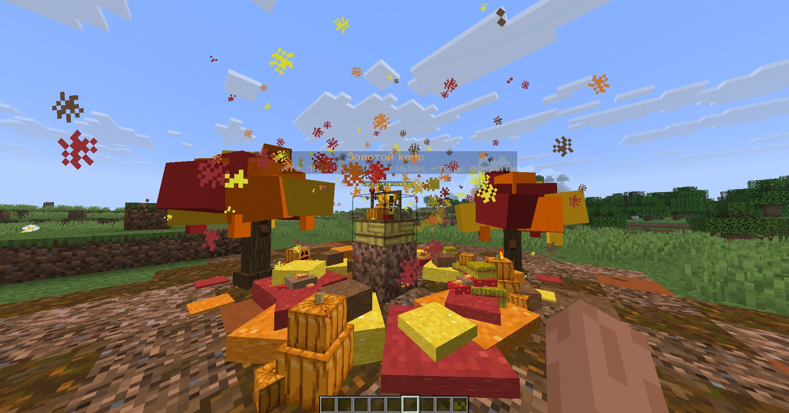
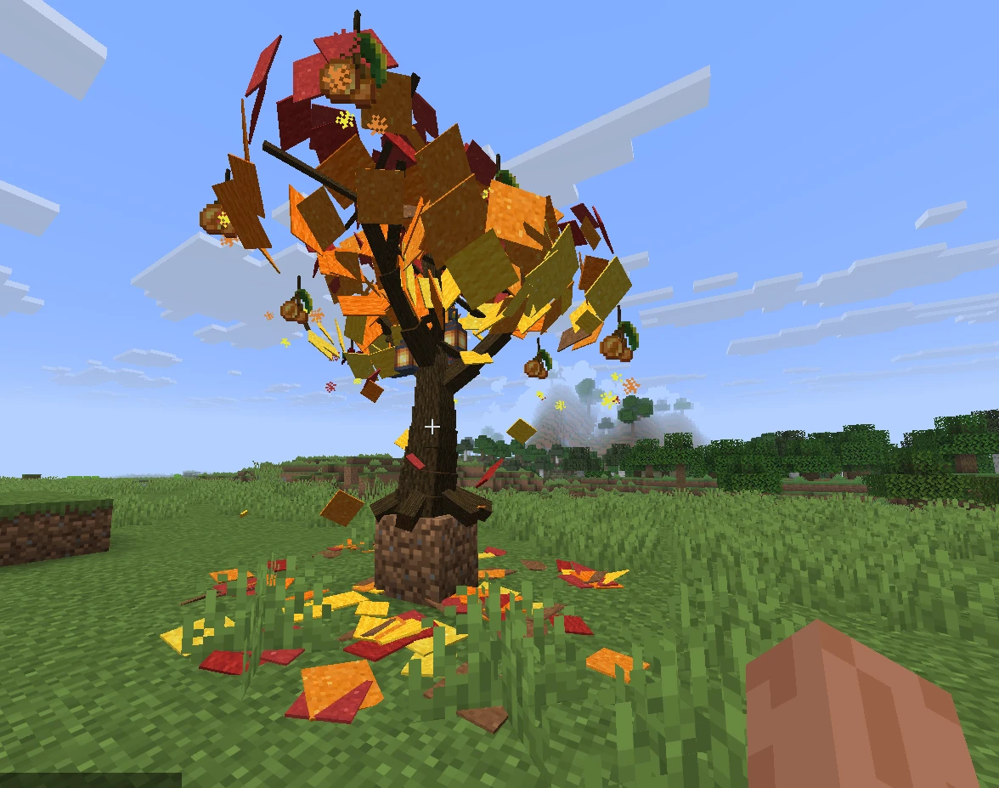
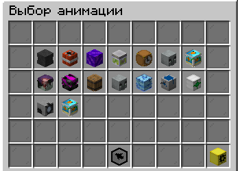
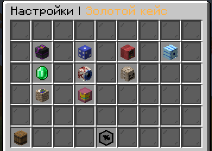
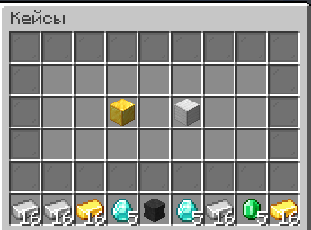

# pnCases 1.5.4-remaster

Paper 1.16.5–26.x. После замены JAR нужен полный перезапуск сервера.

## Главное

**1. Сцены при подходе к кейсу.** Когда игрок подходит к кейсу, вокруг него меняется местность, только для этого игрока, в мире ничего не ломается.
- Осенняя: пугало, клёны, тыквы, грибы, сено, корзина с урожаем вместо блока кейса, музыка и частицы.
- Зимняя (новогодняя): снег, ёлки, снеговики, Дед Мороз, подарок вместо блока кейса. Откроется 1 декабря 2026, до этого показывается осенняя.
- Сцену можно повернуть (0, 90, 180, 270 градусов) и настроить в Machine.



**2. Новые анимации открытия кейса.**
- «Осенний клён».
- «Новогодняя ёлка».
- Новые анимации поворачиваются к открывающему игроку, поэтому награда всегда показывается перед ним, а не сбоку.





**3. Gift: передача ключей.** `/pncases gift <игрок>`: подарить другому игроку 1, 5 или все свои ключи. Право `pncases.gift`.

**4. Открытие сразу несколько раз.** Shift + ПКМ: 1, 3, 5 или 10 кейсов за раз, одна анимация на всю серию и общее окно с наградами.

**5. Machine переделан.** Редактор кейсов прямо в игре, без YAML: создание кейса, добавление наград кликом по предмету, шансы, проверка «что мешает кейсу работать», симулятор шансов на 100 000 открытий, откат правки, привязка блока.



**6. Кейс-контейнер.** Несколько кейсов в одном блоке: игрок открывает блок, выбирает нужный кейс из меню (например, Железный или Золотой) и открывает его. Настраивается в `bundle.cases` или в Machine.



**7. Готовые примеры кейсов.** В `plugins/pnCases/examples/` лежат образцы всех типов наград (предметы, деньги, поинты, LuckPerms, консольные команды) и список всех плейсхолдеров. Сервером они не загружаются, их копируют в `cases`.

**8. Крафт ключей в обычном верстаке.** Ключ кейса теперь можно не только выдать или купить, а сделать самим: игрок раскладывает предметы в обычном верстаке Minecraft, и если раскладка совпала с рецептом, ключ сразу попадает на его счёт. Рецепты вы собираете сами, прямо в игре. Для рецепта подойдут и обычные предметы Minecraft, и особые предметы из других плагинов. На один кейс можно сделать несколько разных рецептов.

## Как сделать рецепт ключа

Рецепты есть у каждого кейса отдельно. По умолчанию их нет, пока вы их не добавите.

**Где настроить.** Два способа, оба открывают одно и то же:
- `/pncases machine` → нужный кейс → «Дополнительно» → «Крафт ключа»;
- `/pncases workbench` (список кейсов) или `/pncases workbench <кейс>` (сразу нужный кейс). Команда только для администраторов.

**Как добавить рецепт.**
1. В списке рецептов нажмите «Добавить рецепт». На кейс можно сделать до 14 рецептов, то есть до 14 разных способов получить один и тот же ключ.
2. Откроется сетка 3×3, как в верстаке. Возьмите нужный предмет в руку (он окажется на курсоре) и нажмите на слот сетки. Предмет в руке при этом не пропадёт.
3. Так заполните нужные слоты. Правый клик по слоту очищает его.
4. «Ключей за крафт» задаёт, сколько ключей получит игрок за один крафт.
5. Кнопкой «Рецепт включён» рецепт включается и выключается. В списке то же делает правый клик по рецепту. Выключенный рецепт не работает.

**Какие предметы можно положить в рецепт.**
- **Любой обычный предмет Minecraft:** алмазы, золото, звезда Незера, книги и так далее. Название и описание у такого предмета не важны.
- **Особые предметы из других плагинов.** Если плагин помечает свои предметы тегом вида `namespace:key` (например, `myplugin:key_shard`), положите такой предмет в слот как образец. Плагин сам прочитает его теги и в игре будет принимать только предметы с этими тегами. Название и описание при этом снова не важны. В подсказке слота видно, какие теги запомнены.
- **Сколько нужно предметов.** Берётся столько, сколько лежит в стопке в вашей руке в момент нажатия. Положите в руку 3 алмаза, и в этом слоте рецепта будет нужно 3 алмаза.

**Что важно знать.**
- Обычный слот не принимает предмет с особыми тегами: особый предмет за обычный не сойдёт. А для особого слота нужны все запомненные теги.
- Рецепт работает строго по слотам, как кастомный рецепт верстака: каждый предмет лежит на своём месте, и в остальных слотах сетки должно быть пусто.
- Работает в обычном верстаке 3×3. В малой сетке 2×2 в инвентаре ключи не создаются.
- Если те же предметы подходят и под обычный рецепт Minecraft, сработает ключ.

**Как это выглядит у игрока.** Игрок раскладывает предметы в верстаке. Когда рецепт собран, в окне результата появляется ключ с названием кейса. Клик по нему списывает предметы и зачисляет виртуальный ключ на счёт, в чат приходит сообщение. Shift + клик создаёт ключи, пока хватает предметов. Сам предмет-ключ игроку в руки не попадает.

**В файле кейса** (`plugins/pnCases/cases/<кейс>.yml`) рецепты лежат в разделе `workbench`. Слоты считаются от 0 до 8 слева направо и сверху вниз:

```yaml
workbench:
  recipes:
    1:
      enabled: true
      result-amount: 1
      slots:
        0: { material: DIAMOND, amount: 2 }
        4: { material: NETHER_STAR, amount: 1, tags: ['myplugin:key_shard'] }
    2:
      enabled: true
      result-amount: 3
      slots:
        3: { material: GOLD_INGOT, amount: 8 }
```

## Как настроить сцену при подходе к кейсу

Сцена по умолчанию выключена. Всё меняется под себя, и в игре, и в файле кейса.

**В игре (Machine):** `/pncases machine` → нужный кейс → «Дополнительно» → «Ближняя анимация». Включаешь сцену и выбираешь, какую: осеннюю или зимнюю (зимняя доступна с 1 декабря 2026). Изменения применяются сразу, без перезагрузки.

Что можно менять:
- **Общее:** радиус, на каком расстоянии сцена появляется, насколько декор разбросан вокруг, плавность появления и исчезновения, поворот сцены (0, 90, 180, 270 градусов).
- **Звук:** музыка и звуки, громкость, пауза между повторами музыки.
- **Частицы:** падающие листья или снег, вихрь, искры, их количество.
- **Декор:** сколько деревьев, куч, тыкв, грибов, снеговиков, гирлянд и подарков.
- **Пугало / Дед Мороз:** вкл/выкл, цвет одежды, фразы, которые он говорит.
- **Мир:** вид кейса вблизи (корзина или подарок, снежный шар, кристалл, обычный блок или без изменений), цвет, земля вокруг (какие блоки и как часто), оставлять ли вид кейса во время открытия.

**В файле кейса** (`plugins/pnCases/cases/<кейс>.yml`) то же самое лежит в разделе `proximity-animation`. Готовый образец с комментариями: `plugins/pnCases/examples/07-proximity.yml`.

```yaml
proximity-animation:
  enabled: true
  scene: AUTUMN        # AUTUMN или WINTER
  radius: 8            # с какого расстояния появляется сцена
  rotation: 90         # поворот сцены: 0, 90, 180 или 270
  music:
    enabled: true
    volume: 0.3
```

**Что важно знать:**
- Игрок видит сцену, только когда стоит рядом. Блоки меняются только на его экране, в мире ничего не ломается.
- Сцену видит каждый игрок отдельно, остальные ничего не замечают.
- Когда игрок уходит, всё плавно исчезает.
- Если выключить в сцене музыку, звуки или частицы, остальное продолжит работать.

## Ещё добавлено

- Избранные анимации для каждого кейса: при открытии выбирается случайная из набора.
- Гарант редкости: если долго не выпадает, награда выпадет гарантированно.
- Несколько команд в одной награде (`commands`); срок LuckPerms-награды и сообщение настраиваются в Machine.
- Плейсхолдеры PlaceholderAPI: `%pncases_keys_<кейс>%`, `%pncases_cases%`, `%pncases_opening%`, `%pncases_version%`.
- Команда `/pncases copycase <откуда> <куда>`.
- Резервная копия настроек в `plugins/pnCases/backups/` при каждом обновлении (5 последних).
- Историю открытий можно отключить (`features.history` в `config.yml`).
- События для других плагинов: `CaseOpenEvent`, `CaseRewardGrantEvent`, `CaseKeyGiveEvent`.
- Админам после 1 декабря приходит одно сообщение о зимней сцене, оно исчезает, когда сцена включена.

## Изменено

- Мобовые анимации проверяют место кейса (сложность мира, запрет спавна). Если нельзя, играет «Круг фортуны», а в меню причина.
- «Призма»: над крутящимися наградами больше нет подписей, название показывается только у выигранной награды.
- Быстрая серия показывает одно сообщение с итогом, а не по сообщению на каждую награду.
- Постоянная группа LuckPerms заменяет временную такую же.
- pnLibrary теперь `0.0.1-dev.5`. Если её нет, pnCases скачает сама (около 7 МБ). Старую pnLibrary 2.x нужно удалить.

## Исправлено

- Цифры после цвета пропадали: версия сервера `26.3` показывалась как `.3`, а числа в меню (страницы, суммы, сроки) могли исчезать.
- Правка суммы награды стирала её сообщение (Vault, PlayerPoints).
- Сообщение награды-предмета и `{amount}` работали неправильно.
- Подписи голограмм FancyHolograms обновлялись с задержкой.
- Ошибка анимаций на Paper 1.20 / 1.20.1.
- Частицы и AnvilGUI на Paper 1.21.11.
- Ошибка при нехватке ключей на SQLite.

## Благодарности

Спасибо за ваши сообщения и идеи: **lolsawq**, **lipsy**, **Секретно**, **𝐅𝐎𝐁𝐙𝐄𝐒**, **𝖋𝖗𝖆𝖟𝖇𝖎𝖐**.

Часть имён тех, кто писал нам, к сожалению, потерялась, поэтому здесь они не указаны. Большое спасибо и вам, и всем остальным за фидбэк: мы видим каждое сообщение, и с вами плагин становится лучше!

## Поддержка

Если возникнут проблемы, ошибки или идеи, пишите в наш [Discord](https://discord.gg/SZxPP9surw). Вам всегда помогут, и не только по pnCases, а по любым вопросам, связанным с плагинами и серверами.
